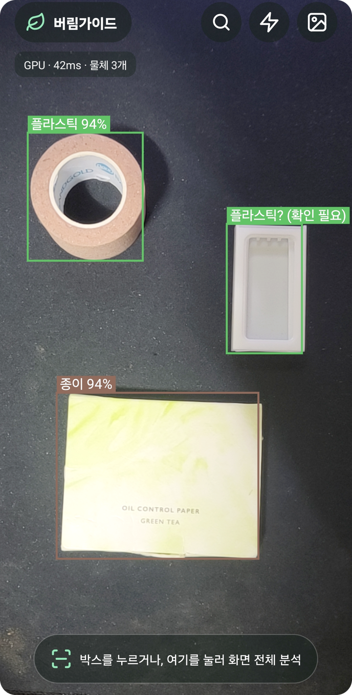
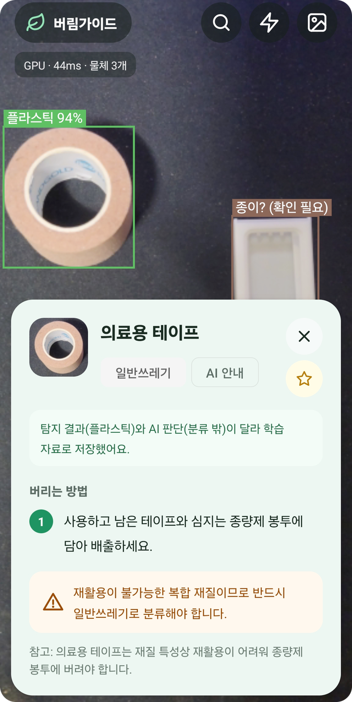
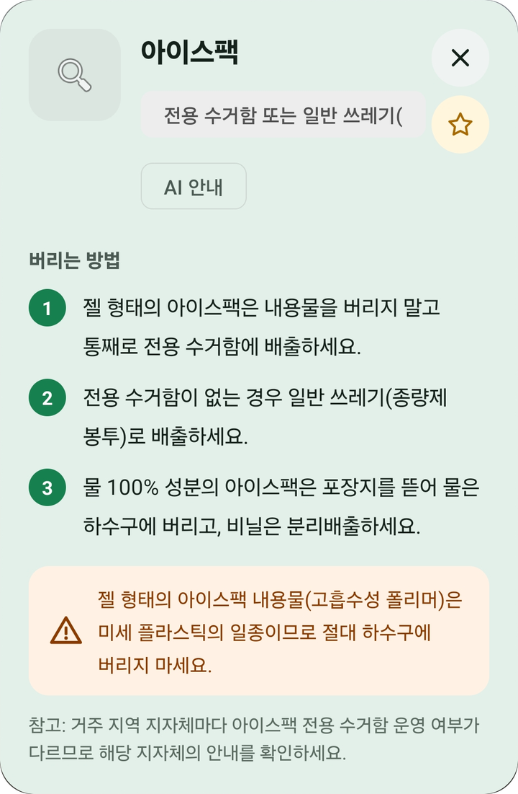
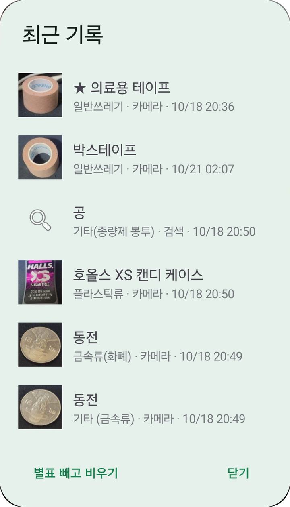
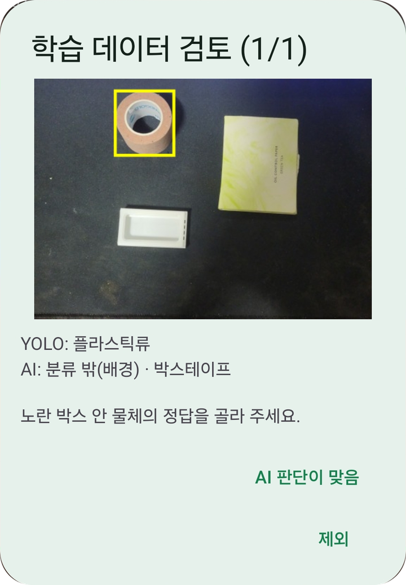
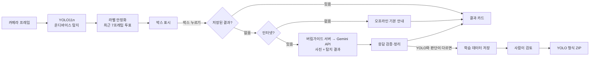

# 버림가이드 (WasteSortingApp)

카메라로 쓰레기를 비추면 **온디바이스 YOLO11**이 물체를 찾고, 누른 물체를 **서버를 거쳐 Gemini API**로 분석해
**한국 기준 분리배출 방법**을 단계별로 알려 주는 Android 앱입니다.
인터넷이 없어도 기본 안내가 나오고, AI와 탐지 모델의 판단이 다른 사례는 모아 두었다가
사람이 검토한 뒤 재학습용 데이터로 내보낼 수 있습니다.

> **백엔드 서버**: [WasteSortingServer](https://github.com/eovk01100-wq/WasteSortingServer) (Spring Boot · MySQL · AWS)
> — Gemini 호출, 계정·분석 기록, 오탐 사진 수집·검수를 담당합니다.
> API 목록과 화면은 서버 저장소 README에서 볼 수 있습니다.

| 실시간 탐지 | AI 안내 결과 | 텍스트 검색 |
|:---:|:---:|:---:|
|  |  |  |

| 최근 기록 | 학습 데이터 검토 |
|:---:|:---:|
|  |  |

## 주요 기능

- **실시간 탐지**: YOLO11n(LiteRT)을 휴대폰에서 직접 실행. GPU 가속, 안 되면 CPU로 자동 전환
- **AI 분리배출 안내**: 박스를 누르면 잘라낸 사진과 탐지 결과를 Gemini에 보내 단계별 배출법·주의사항 표시
- **화면 전체 분석**: 박스가 안 잡히거나 틀릴 때 화면 전체로 질의 (첫 사용 시 개인정보 안내)
- **텍스트 검색 · 갤러리 사진 분석**: 사진 없이 물건 이름으로 검색, 저장된 사진으로도 분석
- **오프라인 기본 안내**: 인터넷이 없거나 요청이 실패하면 7개 분류의 기본 배출법과 [검색하기] [다시 시도] 버튼
- **최근 기록 · 별표**: 받은 안내를 기기에 저장하고 중요한 것은 별표로 보관
- **학습 데이터 수집 · 검토**: YOLO와 AI 판단이 다르면 사진·라벨을 저장 → 앱에서 정답 확정 → YOLO 형식 ZIP으로 내보내기
- **사용 편의**: 핀치 줌, 탭 초점, 플래시, 같은 물체 결과 재사용(캐시)

## 동작 흐름



## 기술 스택

| 구분 | 사용 |
|---|---|
| 언어 · UI | Kotlin, XML Views, Material 3 |
| 카메라 | CameraX 1.4 (Preview + ImageAnalysis) |
| 탐지 모델 | YOLO11n → TFLite(LiteRT 1.0.1), GPU Delegate |
| AI 안내 | 자체 서버 경유 Gemini API (`gemini-3.1-flash-lite`), Retrofit 2.11 + Gson |
| 비동기 | Kotlin Coroutines (요청 취소 · 늦은 결과 무시 처리) |
| 테스트 | JUnit 4 단위 테스트 46개 |

## 모델

- 데이터: [셀렉트스타 생활폐기물 객체인식 데이터셋](https://open.selectstar.ai/ko/dingbro) (CC BY-SA 3.0)
- 7개 분류: `can` `glass` `pack` `paper` `pet` `plastic` `vinyl`
- yolo11n, 입력 640×640, **mAP50 0.864**
- `assets/waste_yolo11n_fp32.tflite`, `assets/labels.txt`
  (앱 시작 시 분류 개수와 순서를 `WasteClasses.kt`와 비교해서 다르면 사용하지 않음)

## 성능 (Galaxy Quantum 2, GPU)

| 구간 | 최적화 전 | 최적화 후 |
|---|---:|---:|
| 프레임 변환 | 22 ms | 25 ms |
| 전처리 | 107 ms | **10 ms** |
| 추론 | 62 ms | 62 ms |
| 후처리 | 66 ms | **2 ms** |
| **합계** | **약 257 ms** | **약 99 ms (2.6배)** |

- 전처리: 레터박스 비트맵·캔버스·배열 재사용, 픽셀 일괄 복사
- 후처리: 출력 배열 직접 접근, 점수 낮은 후보 조기 제외
- 15분 연속 사용 점검: 메모리 약 210MB에서 안정(+5MB), 처리 시간 70~90ms 유지

## 프로젝트 구조

```
app/src/main/java/com/jiwoo/wastesorting/
├─ MainActivity.kt      화면 연결, 카메라, 추론 루프, 요청 흐름
├─ ResultCard.kt        결과 카드 (로딩 · 안내 · 별표 · 실패 버튼)
├─ FeedbackDialogs.kt   학습 데이터 창 · 검토 화면 · ZIP 내보내기
├─ HistoryDialog.kt     최근 기록 창
├─ OverlayView.kt       박스 그리기 · 탭 · 핀치 줌
├─ YoloDetector.kt      LiteRT 추론 (전처리 · 후처리 · NMS)
├─ LabelStabilizer.kt   박스 추적 + 프레임 투표   ─ StabilizerMath.kt (계산)
├─ GeminiClient.kt      Gemini 요청             ─ GeminiParser.kt (응답 검증)
├─ OfflineGuide.kt      오프라인 기본 안내 · 검색어 판단
├─ ResultCache.kt       같은 물체 결과 재사용
├─ HistoryStore.kt      기록 저장 (임시 파일 후 교체)
├─ FeedbackSaver.kt     학습 데이터 저장
├─ FeedbackManager.kt   검토 상태 · ZIP 생성
└─ WasteClasses.kt      분류 목록 · 정규화 · 한글 이름
```

## 테스트

`app/src/test`의 단위 테스트 46개 (Android Studio에서 `test` 폴더 우클릭 → Run)

| 대상 | 내용 |
|---|---|
| WasteClasses | 분류 정규화, 순서 검사, 한글 이름 |
| OfflineGuide | 품목 이름 판단, 예외 품목(깨진 유리 등) 추측 금지 |
| GeminiParser | 코드블록 응답, 빈 응답, 길이 제한, 잘못된 분류 값 |
| StabilizerMath | 프레임 투표, 확인 필요 판정, 박스 겹침(IoU) |
| FeedbackManager | 학습 라벨 형식 |

테스트로 찾아 고친 문제: "우유 종이팩"이 종이로 판단되던 문제, AI 응답 단계에 `null`이 섞이면 앱이 멈추던 문제

## 해결한 문제들

- **NCHW 입력 모델**: 내보낸 모델이 `[1,3,640,640]` 형식이라 입력 배치를 채널 우선으로 변환
- **라벨 흔들림**: 프레임마다 바뀌는 라벨을 박스 추적 + 점수 가중 투표로 안정화, 표가 갈리면 "확인 필요" 표시
- **늦게 도착한 결과**: 화면 모드가 바뀌면 요청 번호를 올리고 실제 네트워크 요청까지 취소해, 지난 결과가 표시·저장되지 않게 처리
- **AI 응답 검증**: JSON 형식 강제, 길이 제한, 허용된 분류 값만 사용
- **학습 데이터 품질**: AI 판단도 틀릴 수 있어 사람이 검토해 확정한 사례만 내보냄

## 실행 방법

1. Android Studio에서 프로젝트 열기 (minSdk 24)
2. `local.properties`에 서버 주소 추가 (Git에 올리지 않음)
   ```
   SERVER_URL=https://서버-주소/
   ```
   서버는 직접 띄워서 그 주소를 넣습니다. 서버 실행 방법은 [WasteSortingServer](https://github.com/eovk01100-wq/WasteSortingServer) 참고
3. 실제 기기를 연결하고 실행

## 주의

- Gemini API 키는 앱에 없고 **서버에만** 있습니다. 앱은 서버가 발급한 토큰으로 요청합니다.
- 오탐 사진의 서버 전송은 기본으로 꺼져 있고, 사용자가 동의해야 켜집니다.
- 분리배출 안내는 AI가 만들기 때문에 지역 규정과 다를 수 있습니다.
- 처리하는 정보와 보관 기간: [개인정보처리방침](PRIVACY.md)

## 라이선스 · 출처

- **코드**: 포트폴리오 열람용으로 공개합니다. 별도 허락 없이 복제·수정·재배포할 수 없습니다. (All rights reserved, [LICENSE](LICENSE) 참고)
- **학습 데이터**: [셀렉트스타 생활폐기물 객체인식 데이터셋](https://open.selectstar.ai/ko/dingbro) — 저작자 셀렉트스타, [CC BY-SA 3.0](https://creativecommons.org/licenses/by-sa/3.0/deed.ko)
- **모델 파일** (`app/src/main/assets/waste_yolo11n_fp32.tflite`): 위 데이터셋으로 학습한 결과물로, 데이터셋과 같은 CC BY-SA 3.0 조건을 따릅니다.
